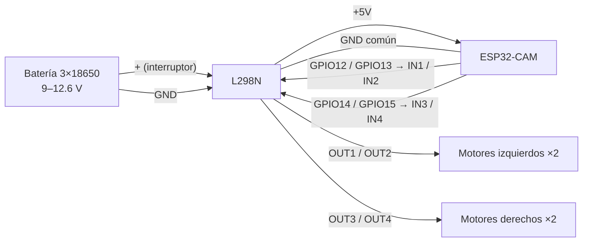

# Prueba de funcionalidad de un robot móvil diferencial

**Curso:** Robótica · **Carrera:** Ingeniería en Computación
**Integrante:** Fer (trabajo individual) · **Fecha:** ____________
**Repositorio:** https://github.com/igream/ESP32-AI-Robot

> Borrador. Los campos `____` y las tablas vacías se llenan con las mediciones; las tablas de la sección 6 las genera `herramientas/calibrar.py analizar` en `herramientas/datos/analisis/resumen.md`.

---

## 1. Objetivo

Armar y verificar un robot móvil de ruedas diferencial basado en ESP32-CAM y L298N. El robot ejecuta rutinas de movimiento básicas (adelante, atrás, giro a la izquierda, giro a la derecha y vuelta de 360°). Esas rutinas se calibran con un procedimiento estadístico, para saber cuánto se mueve el robot de forma precisa y poder ordenarle desplazamientos por coordenadas.

## 2. Materiales

| Material | Detalle |
|---|---|
| Kit LaFvin ESP32 Camera 4WD Robot Car V3 | Chasis, 4 motores TT con reductora y llantas |
| ESP32-CAM (AI-Thinker) con cámara OV3660 | Microcontrolador + WiFi + cámara |
| Placa de programación ESP32-CAM-MB | USB–serie CH340 |
| Driver L298N | Puente H doble, hasta 2 A por canal |
| Baterías | 3 × 18650 (11.1 V nominal, 12.6 V cargadas) |
| Software | Arduino IDE / arduino-cli, core ESP32 3.3.12; Python 3 con numpy, scipy y matplotlib |
| Medición | Cinta métrica, cinta de color, multímetro, cámara de video |

## 3. Conexiones

### 3.1 Tabla de pines

| ESP32-CAM | L298N | Función en el código |
|---|---|---|
| GPIO12 | IN1 | `LEFT_M1`: lado izquierdo, adelante |
| GPIO13 | IN2 | `LEFT_M0`: lado izquierdo, reversa |
| GPIO14 | IN3 | `RIGHT_M0`: lado derecho, reversa |
| GPIO15 | IN4 | `RIGHT_M1`: lado derecho, adelante |
| 5V | +5V (salida del regulador del L298N) | Alimentación del ESP32-CAM |
| GND | GND | Tierra común |
| — | ENA, ENB | Jumpers puestos (siempre habilitados) |
| — | OUT1/OUT2 | 2 motores del lado izquierdo en paralelo |
| — | OUT3/OUT4 | 2 motores del lado derecho en paralelo |
| Batería + (por el interruptor) | +12V | Alimentación de motores |

> Verificar con el robot armado que IN1/IN2 correspondan al lado izquierdo; si no, intercambiar en `robot_motion.h`.

Los pines 12–15 se comparten con la ranura microSD, que no se usa. Pines ocupados por la cámara: 0, 5, 18, 19, 21–23, 25–27, 32, 34–36 y 39. El GPIO4 es el LED flash y el GPIO33 es el LED rojo de la placa. GPIO12 es un pin de arranque (strapping): si está en alto al encender, el ESP32 elige 1.8 V para la flash y no arranca. Con el L298N conectado arranca bien porque las entradas del L298N no lo jalan a alto.

### 3.2 Diagrama

*(Agregar foto del robot armado y del diagrama dibujado.)*

## 4. Diseño del control de velocidad

- **PWM en los pines IN.** Con los jumpers ENA/ENB puestos, la velocidad se regula mandando PWM a la entrada de un sentido y 0 a la otra. Así no se necesitan dos pines más para ENA/ENB, que el ESP32-CAM ya no tiene libres. El PWM es de 2 kHz y 8 bits, en los canales LEDC 4–7 con el timer 1, porque la cámara usa el canal 0 y el timer 0.
- **Límite de voltaje.** El manual no especifica los motores y no tienen etiqueta, así que se asume un motor TT típico de 3–6 V. Con la batería llena (12.6 V) y unos 2 V de caída en el L298N, el motor recibe ~10.6 V con PWM al 100 %. El firmware limita el PWM a `pwm_max = 145` (≈57 % → ~6 V promedio). El código original del fabricante usa 150, lo que confirma la estimación.
- **Corrección por lado.** Los factores `trim_i` y `trim_d` (0.3–1.0) reducen el lado más rápido para que el robot vaya recto.

## 5. Código

El firmware está en `firmware/robot_esp32cam/`:

| Archivo | Contenido |
|---|---|
| `robot_esp32cam.ino` | Cámara, WiFi en modo punto de acceso (`ESP32Car_Fer`) y ciclo principal |
| `robot_motion.h/.cpp` | Funciones `adelante()`, `atras()`, `izquierda()`, `derecha()`, `detener()`, `girar360()`; cola de movimientos no bloqueante; secuencia de la tarea; prueba de PWM mínimo; movimiento por coordenadas; calibración guardada en flash; comandos por monitor serie |
| `app_httpd.cpp` | Servidor web: video, botones y endpoints `/move`, `/seq`, `/mot`, `/pwmmin`, `/g360`, `/cm`, `/grados`, `/ir`, `/estado`, `/config` |

Los movimientos con duración no usan `delay()`: se encolan y `robot_loop()` los ejecuta comparando `millis()`. Así el video y el servidor web siguen respondiendo, y el monitor serie imprime cada etiqueta con su marca de tiempo y la duración real medida.

Script de calibración: `herramientas/calibrar.py` (ver `herramientas/README.md`).

*(Agregar captura del código funcionando y del monitor serie.)*

## 6. Resultados

### 6.1 Parte B – Prueba individual de motores

Ruedas en el aire. Sentido: comando `mot`. PWM mínimo: comandos `min i` / `min d` (rampa de 5 en 5 cada 0.4 s), escribiendo `ok` al ver girar la rueda.

| Motor | PWM mínimo (rep. 1 / 2 / 3) | Promedio | Sentido correcto (Sí/No) | Observaciones |
|---|---|---|---|---|
| Izquierdo | ___ / ___ / ___ | ___ | ___ | |
| Derecho | ___ / ___ / ___ | ___ | ___ | |

### 6.2 Parte C – Rutinas de movimiento

Secuencia (comando `seq` o botón **Secuencia**): inicio de 3 s, adelante, atrás, izquierda 90°, derecha 90° y giro de 360°, con 1 s de pausa entre movimientos.

| # | Movimiento | PWM izq / der | Duración inicial | Duración calibrada |
|---|---|---|---|---|
| 1 | Adelante | +140 / +140 | 2000 ms | ___ |
| 2 | Atrás | −140 / −140 | 2000 ms | ___ |
| 3 | Giro izquierda | −140 / +140 | 500 ms | ___ |
| 4 | Giro derecha | +140 / −140 | 500 ms | ___ |
| 5 | Giro 360° | −140 / +140 | 1800 ms | ___ |

### 6.3 Parte D – Calibración y medición (mínimo 3 repeticiones; se recomiendan 10)

| Movimiento | Tiempo (ms) | Resultado esperado | Resultado medido (media ± DE, n) | Error |
|---|---|---|---|---|
| Adelante | ___ | Línea recta de 1 m | Desviación lateral: ___ cm | ___ |
| Atrás | ___ | Regreso al punto de inicio | Distancia al origen: ___ cm | ___ |
| Izquierda | ___ | 90° | Ángulo: ___° | ___ |
| Derecha | ___ | 90° | Ángulo: ___° | ___ |
| 360° | ___ | 360° | Ángulo: ___° | ___ |

### 6.4 Análisis estadístico

*(Pegar aquí las tablas y gráficas de `herramientas/datos/analisis/resumen.md`: descriptiva, regresión, comparaciones y validación por coordenadas.)*

## 7. Preguntas de análisis

**1. ¿Por qué el robot se desvía en línea recta aunque ambos motores reciben la misma señal?**
Porque es un control en lazo abierto: el mismo PWM no garantiza la misma velocidad. Influyen:
- Las tolerancias de fabricación de los motores TT y sus reductoras (fricción y holgura distintas).
- Pequeñas diferencias en el diámetro o el montaje de las llantas.
- La distribución del peso.
- Que cada lado arranca con un PWM mínimo distinto (Parte B).
- Diferencias de caída de voltaje entre los dos canales del L298N.

Una diferencia de velocidad de pocos por ciento produce una curvatura constante, y la desviación lateral crece con el cuadrado de la distancia: y ≈ κ·D²/2. Resultado medido: ___ cm a 1 m (prueba t: p = ___).

**2. ¿Qué diferencia hay entre girar con un motor detenido y girar con motores en sentidos opuestos?**

| | Un motor detenido (pivote) | Motores opuestos (sobre su eje) |
|---|---|---|
| Centro de giro | La rueda detenida | El punto medio entre las ruedas |
| Velocidad angular | ω = v / L | ω = 2v / L (el doble) |
| El robot se desplaza | Sí, su centro describe un arco de radio L/2 | No, gira en su lugar |
| Uso | Giros suaves en movimiento | Cambiar de orientación sin moverse |

En un robot 4WD como este, los dos tipos de giro hacen derrapar las llantas delanteras y traseras, por eso el giro real es más lento que el teórico. Medido a 500 ms: eje = ___°, pivote = ___° (t de Welch p = ___).

**3. ¿Cómo afecta la caída de voltaje del L298N y el nivel de batería al comportamiento?**
El L298N usa transistores bipolares y pierde unos 2 V (1.8–3.2 V según la corriente). Con el mismo PWM, el voltaje promedio del motor es aproximadamente PWM/255 · (V_bat − 2 V):
- Batería llena (12.6 V) y PWM 140: ≈ 5.8 V.
- Batería baja (~9.6 V bajo carga) y el mismo PWM: ≈ 4.2 V, es decir ~28 % menos velocidad.

Por eso los tiempos calibrados solo valen para un rango de carga de batería, y la desviación cambia si un canal pierde más que el otro. Medido: correlación voltaje–avance r = ___ (p = ___). Mitigaciones:
- Medir la batería y compensar el PWM.
- Usar un driver MOSFET (por ejemplo TB6612FNG, con ~0.5 V de caída).
- Cerrar el lazo con sensores.

**4. Ecuaciones cinemáticas y tiempo teórico de 90°**
- v = (v_R + v_L) / 2,  ω = (v_R − v_L) / L.
- Giro sobre su eje: v_R = v, v_L = −v, así que ω = 2v / L.
- Tiempo para 90°: t₉₀ = (π/2) / ω = π·L / (4v).

Con L = ___ cm y v = ___ cm/s (pendiente de la regresión), t₉₀ teórico = ___ ms contra ___ ms medidos.

La diferencia se explica con la L efectiva = 2v/ω_medida = ___ cm (factor de derrape L_ef/L = ___): en un 4WD con dirección por derrape, las llantas se arrastran de lado al girar.

**5. Mejora propuesta**
- **IMU MPU6050** (ya comprada): medir el ángulo real y cerrar el lazo de los giros con un control PID sobre la orientación.
- **Coprocesador ESP32-WROOM-32D** dedicado a motores y sensores, conectado por UART. Libera pines, lo que permite usar ENA/ENB con PWM, leer encoders, leer el voltaje de la batería y conectar el sensor ultrasónico HC-SR04P.
- **Raspberry Pi 5** para visión y voz locales, usando el video del ESP32-CAM por WiFi.
- **Compensación de batería:** PWM = PWM_calibrado · V_calibración / V_actual.

## 8. Problemas encontrados y soluciones

| Problema | Solución |
|---|---|
| Velocidad fija (`speed = 150`) y sin regulación | Funciones con PWM configurable, corrección por lado y límite `pwm_max` |
| Movimientos con `delay()` bloquean el servidor web y la cámara | Cola de movimientos no bloqueante con `millis()` |
| El servidor web solo admite 8 rutas por defecto | `config.max_uri_handlers = 24` |
| El log de cada cuadro de video llenaba el monitor serie | Se desactivó con `LOG_STREAM 0` |
| Arduino exige que la carpeta se llame igual que el `.ino` | Firmware movido a `firmware/robot_esp32cam/` |
| Calibración perdida al reiniciar | Parámetros guardados en flash (NVS) con `Preferences` |
| ___ | ___ |

## 9. Conclusiones

*(Individuales.)*
